<p align="center">
  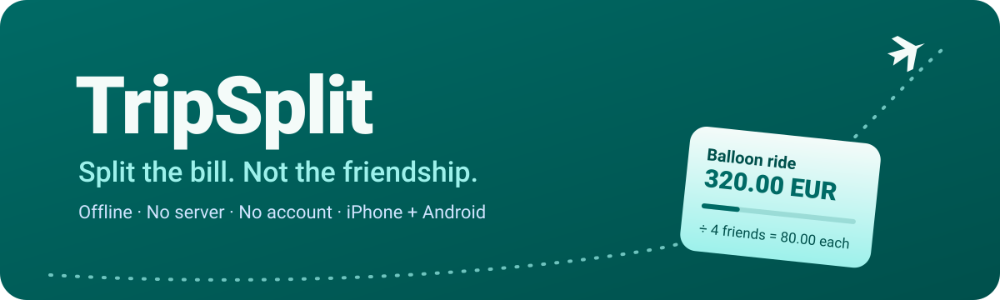
</p>

<p align="center">
  <a href="https://github.com/olcayertas/trip-split/actions/workflows/core.yml"></a>
  <a href="https://github.com/olcayertas/trip-split/actions/workflows/ios.yml"></a>
  
  
  
  
</p>

# 🧳 TripSplit

You are in a cave hotel in Cappadocia. Ayşe paid for breakfast. Ali paid for the hotel. Mehmet paid
for the balloon. Zeynep paid for a taxi in Turkish lira. There is no signal.

**TripSplit keeps the list, and it says who pays whom at the end.** It needs no internet, no server and
no account. The phones in the group talk to each other directly.

## ✨ What it does

| | |
|---|---|
| 📴 **Works offline** | Everything stays on your phones. Airplane mode is fine. |
| 📡 **Syncs nearby** | Phones sync over the same Wi-Fi, a phone hotspot or Bluetooth. |
| 🧾 **Anyone adds** | Every member can add and edit expenses. Nobody is "the accountant". |
| ⚖️ **Fair splits** | Split equally, by exact amounts, or by weights ("Mehmet ate for two"). |
| 💱 **Many currencies** | Pay in lira, see the total in euros. You set the rate. |
| 🤝 **Settle up** | TripSplit finds a short list of payments that clears all the debts. |
| 🙋 **Join later** | A friend joins on day 3, scans a QR code and gets the full history. |
| 🍏🤖 **iPhone + Android** | Two native apps. They sync with each other byte for byte. |

## 📸 Screenshots

<p align="center"><b>Light</b></p>
<p align="center">
  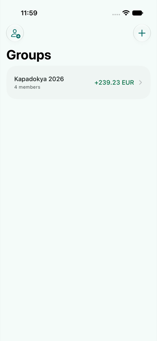
  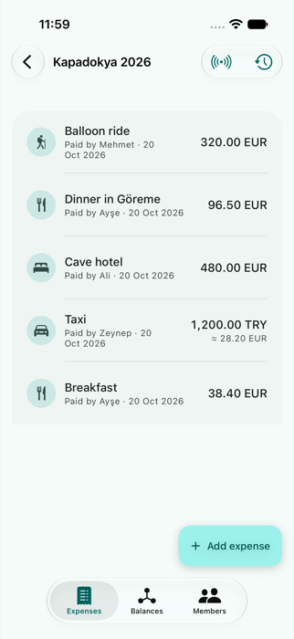
  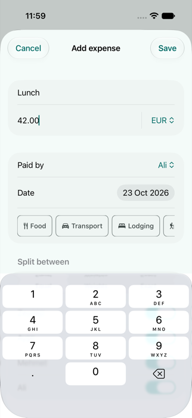
  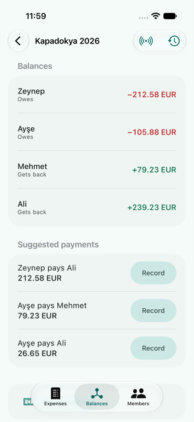
  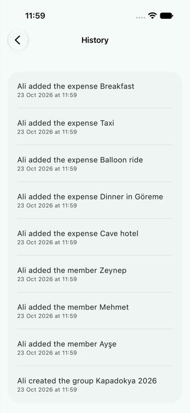
</p>

<p align="center"><b>Dark</b></p>
<p align="center">
  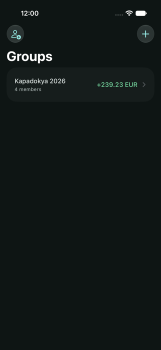
  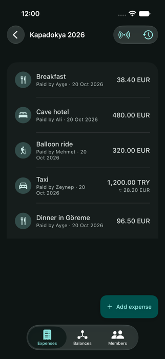
  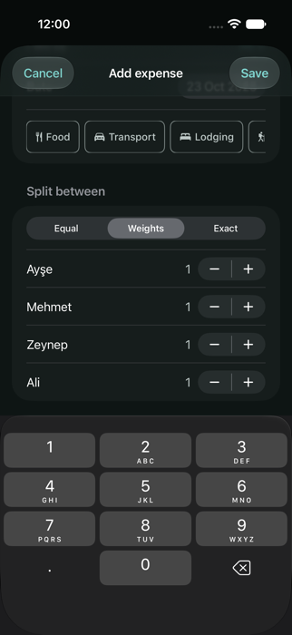
  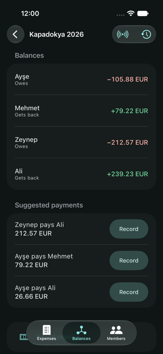
  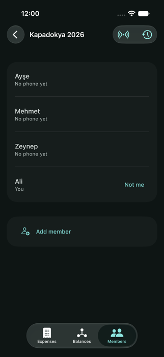
</p>

<details>
<summary>More screens</summary>
<p align="center">
  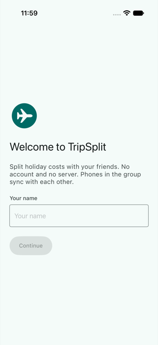
  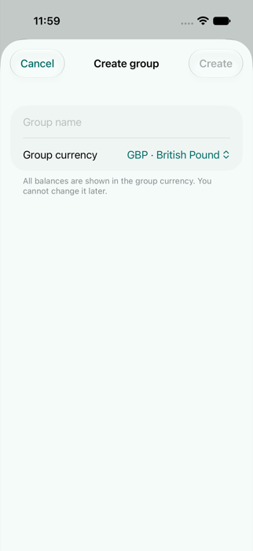
  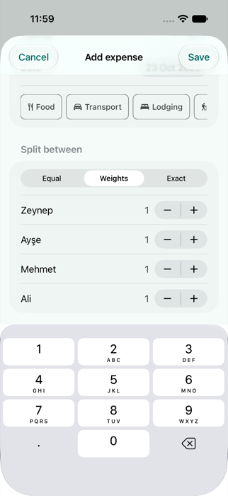
  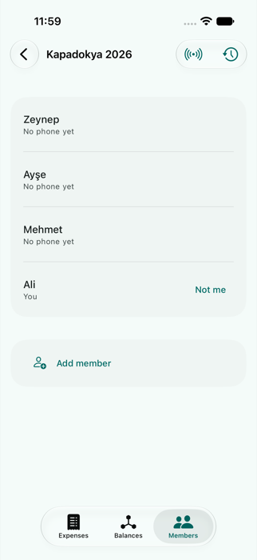
  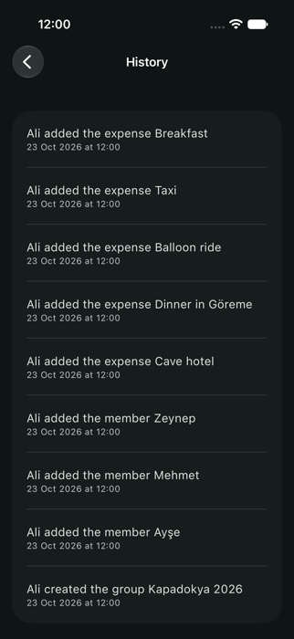
</p>
</details>

<sub>iPhone screenshots. Android screenshots come with the Android UI.</sub>

## 🪄 How the magic works

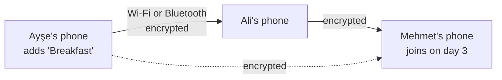

- **No server, so no single truth.** Each phone keeps an append-only log of changes. When two phones
  meet, each sends the changes that the other phone does not have yet.
- **Same log, same result.** The log is a CRDT. Every phone that has the same changes shows the same
  balances, in any order of arrival.
- **Only your group can read it.** The QR invite holds a secret group key. Every sync session is
  encrypted with AES-GCM and a fresh key from that group key.
- **Money is exact.** Amounts are whole minor units (cents). Rounding is half-even, and the last cent
  always goes to somebody in a fixed, fair order. The balances always add up to zero.

## 🧪 Two apps, one truth

The iOS app and the Android app share **no code**. They share a contract:

```
protocol/SPEC.md          the rules, in words
protocol/reference/       a Python model of the rules (the oracle)
protocol/vectors/*.json   golden test cases that the oracle writes
```

Both apps must pass every vector. If Swift and Kotlin disagree by one cent, CI goes red.
There is also a Python peer (`protocol/tools/peer.py`) that syncs with a real phone over Wi-Fi.

## 🗺️ Repo map

| Folder | What lives there |
|---|---|
| [`apple/`](apple/) | The SwiftUI app: `Core`, `Store` (GRDB), `Net` (Bonjour and Bluetooth) |
| [`android/`](android/) | The Jetpack Compose app and its Kotlin core |
| [`protocol/`](protocol/) | The spec, the reference model, the vectors and the test peer |
| [`design/`](design/) | Material 3 colour tokens from one seed colour, for both apps |
| [`docs/`](docs/) | The [plan](docs/PLAN.md), the [release runbook](docs/RELEASING.md) and the [privacy policy](docs/privacy/index.md) |

## 🚦 Status

| Phase | iPhone | Android |
|---|---|---|
| Core: ops, fold, money, settlement | ✅ | ✅ |
| Sync engine: crypto, frames, sessions | ✅ | ✅ |
| Storage | ✅ | ✅ |
| UI | ✅ | ✅ |
| Wi-Fi sync | ✅ | ✅ |
| Bluetooth sync | ✅ | ✅ |
| QR invite and member claim | ✅ | ✅ |
| TestFlight and APK | 🛠️ | 🛠️ |
| Field test on real phones | 🧪 | 🧪 |

✅ means built and tested on simulators and with the reference peer. Real radios come with the
[field test](docs/FIELD_TEST.md).

Work is tracked in issue [#1](https://github.com/olcayertas/trip-split/issues/1).

## 🛠️ Build it

```bash
# Check the vectors against the reference model
python3 protocol/reference/gen_vectors.py --check

# Swift core tests
cd apple/Core && swift test

# Kotlin core tests (JDK 21)
cd android && ./gradlew :core:test
```

The iOS project comes from XcodeGen (`apple/project.yml`). The release steps are in
[docs/RELEASING.md](docs/RELEASING.md).

## 🔐 One serious note

The QR invite **is** the group key. Anyone who has it can read and change the group. Show it only to
the people on your trip. Read the [privacy policy](docs/privacy/index.md): TripSplit collects no data.

<p align="center"><sub>Made for long dinners, shared taxis and the friend who always "forgets" their wallet. 🍽️🚕💸</sub></p>
